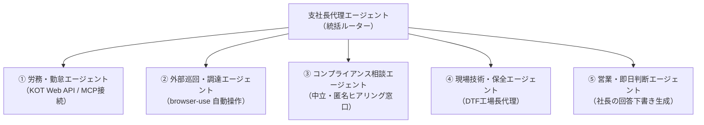

# 【サブエージェント＆ツール設計】可能性のある5大エージェント群と連携アーキテクチャ

## 1. エージェント群の全体像と役割分担

現場の作業代替と「最小限のHuman-in-the-Loop」を実現するため、業務領域ごとに役割と権限を明確に分離したサブエージェント構成を定義します。

---

## 2. 各サブエージェントの詳細設計

### ① 労務・勤怠エージェント（Tool: KING OF TIME MCP）
* **主な役割**:
  * 現場スタッフからの日常的な勤怠・シフト・有休照会に即答する。
* **接続方式**:
  * **KING OF TIME 公式 Web API** をラップした専用 MCP サーバー。
* **実行機能**:
  * 有給残日数照会（「今月あと何日有休残ってますか？」）
  * シフトスケジュール照会（小作工場の当週・翌週シフト照合）
  * 打刻漏れ・過重労働のアラート検知（月次・週次の自動確認）
* **セキュリティ・権限**:
  * 給与・マイナンバー等にはアクセスさせず、**「勤怠・シフト・休暇残日数の読み取り専用」**に制限。

### ② 外部巡回・調達エージェント（Tool: browser-use）
* **主な役割**:
  * 公式APIが提供されていない外部Webサイトの定期巡回・データ収集を自動化。
* **接続方式**:
  * **browser-use（Playwrightベースのブラウザ自動操作）**
* **実行機能**:
  * **バイトル管理画面巡回**: パート募集の応募状況を定期チェックし、新着応募があれば要約してチャット通知。
  * **仕入先サイト在庫チェック**: 無地Tシャツ（Printstar、United Athle等）の発注サイトを巡回し、欠品状況を事前アラート。

### ③ コンプライアンス相談エージェント（中立な内部通報・一次相談窓口）
* **主な役割**:
  * 家族経営から脱却した組織における、心理的安全性の高い中立な相談窓口。
* **動作ポリシー**:
  * **完全中立・傾聴**: パート・B型作業者からの不満や労務相談を感情の対立なく受け止める。
  * **客観ルール照合**: 新就業規則、労働基準法、Fanatics監査基準に基づき「会社の規則上はどう規定されているか」を客観提示。
  * **エスカレーション**: 深刻な法令違反・ハラスメント案件は、感情表現を排した「事実の要約レポート」に変換し、経営陣・顧問社労士・外部株主（山本氏・伊藤氏）へ直接通知。
  * **制約**: AIは処分や裁定を下さない。

### ④ 現場技術・保全エージェント（DTF工場長代理）
* **主な役割**:
  * 印刷現場で発生するマシントラブルの一次切り分けと、現場作業者への復旧手順案内。
* **参照ナレッジ**:
  * `knowledge_base_technical.md`（白インク、ワイパー、パウダー、フィルム静電気）
* **実行機能**:
  * 「白インクがかすれた」「パウダーが落ちない」等の相談に対し、症状ごとのチェックリスト（ノズルチェック ➔ パージ ➔ 手動清掃）を案内。
  * 復旧しない場合のみ、機械番号と症状をまとめて澤田社長またはアステム保守へエスカレーション。

### ⑤ 営業・即日判断エージェント（社長の回答下書き生成）
* **主な役割**:
  * 特急納期や大口見積の相談に対し、澤田社長の思考基準に沿った回答案を作成。
* **参照ナレッジ**:
  * `knowledge_base_business.md`（粗利64%、即日プレミアム価格、閑散期/繁忙期キャパ）
* **運用スタイル**:
  * 現場や顧客への直接送信は行わず、**澤田社長のチャットへ「澤田ならこう答えるよ案」を提示**。
  * 社長が「コピペで送る」または「1行修正して戻す」ことで、最小工数で精度向上を図る。
