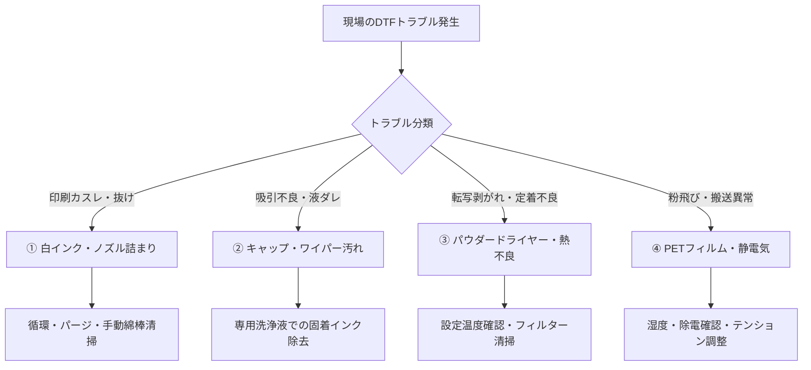

# 【技術ナレッジ】DTF印刷機の機材情報・トラブル対応・予防保全ノウハウ

## 1. サムライTシャツ保有設備情報（Web調査結果）

* **メーカー**: 株式会社アステム（ASTEM）
* **主力機材**: **ARTJET（アートジェット）** シリーズ（複数台運用中）
* **想定される導入型番**:
  * **2ヘッド標準機**:
    * プリンター本体: `AJ-0100`（CMYK + W水性顔料インク、EPSONヘッド2基）
    * シェイクパウダードライヤー: `AJ-0200`
  * **4ヘッド高速・上位機（ART JET EX）**:
    * プリンター本体: `AJ-0120`（ヘッド4基、クリーニング液搭載、インクダンパー簡易ヒーター付）
    * シェイクパウダードライヤー: `AJ-0220`
* **メーカー純正消耗品・メンテナンスパーツ**:
  * 洗浄液: `AJ-4005`
  * クリーンスティック: `AJ-4210`
  * ポリウエスワイパー: `AJ-4220`
  * フィルターエレメントキット: `AJ-4300`

---

## 2. DTF現場における主要トラブル＆予防保全（4大頻出領域）

過去の業務相談・現場の問い合わせにおいて、最も発生頻度が高いと想定されるトラブルと基本対処ロジックです。

### ① 白インクの沈殿・ノズル詰まり（最頻出）
* **原因**: 白インクに含まれる高比重の酸化チタン（顔料）が流路やヘッド内で沈殿・固着する。
* **現場症状**: 白のカスレ、下地が透ける、特定のノズル列が抜ける。
* **基本対処・予防**:
  * 毎朝の自動循環・攪拌動作の確認。
  * ノズルチェックパターンの印刷と通常クリーニング（ヘッドパージ）。
  * 改善しない場合の専用洗浄液＋クリーンスティック（`AJ-4210`）によるヘッド周辺の手動清掃。

### ② キャップステーション・ワイパーの汚れ・固着
* **原因**: 吸引口（キャップ）やワイパーゴムに余剰インクが固着し、密閉性が低下。
* **現場症状**: クリーニングをかけてもインクが吸引されない、ヘッドにインクカスが付着して印字汚れが発生。
* **基本対処・予防**:
  * ワイパーブレードおよびキャップゴム外周のインク固着を、専用洗浄液を含ませたポリウエスワイパー（`AJ-4220`）で拭き取り。

### ③ パウダードライヤー（AJ-0200/0220）の加熱・塗布トラブル
* **原因**: ホットメルトパウダーの塗布ムラ、または乾燥炉の温度不足・ヒーター経年劣化。
* **現場症状**: Tシャツへのプレス転写時にマークが剥がれる、洗濯堅牢度が落ちる、パウダーが溶け切らずザラザラが残る。
* **基本対処・予防**:
  * ドライヤーの設定温度（設定値と実測値）の確認。
  * 排気フィルター（`AJ-4300`等）の目詰まりチェックと定期交換。

### ④ PETフィルム搬送・静電気トラブル
* **原因**: 冬場の乾燥等による静電気発生、フィルム送りテンションの狂い。
* **現場症状**: 絵柄以外の余白部分にパウダーが付着する（粉飛び・地汚れ）、送りズレによる版ズレ。
* **基本対処・予防**:
  * 現場の湿度管理（50〜60%維持）。
  * 除電バーの清掃、フィルム装填時の平行・テンション調整。

---

## 3. エージェントへの知識注入計画

1. **メーカー公式資料の補完**:
   * 詳細な保守手順書はネット非公開のため、澤田社長の手元にある「購入時マニュアル（紙・PDF）」を作業フォルダに提供してもらう。
2. **切り分けアルゴリズムの実装**:
   * 現場からの「印字がかすれた」「パウダーが落ちない」等の相談に対し、
     1. 現状の症状確認（ノズルチェック印刷結果など）
     2. 一次対処（現場で数分でできる清掃・リセット）
     3. 復帰しない場合のエスカレーション（社長・メーカー保守連絡）
     を順序立てて案内するスキルとして整備する。
