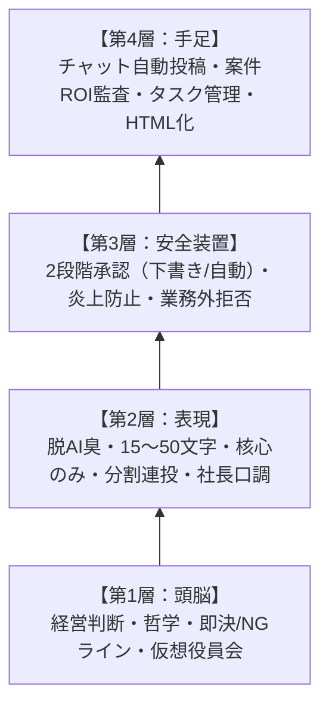

# 【SMB社長代理くん 構築フレームワーク】
### 〜「山本圭代理」の実証実績から抽出した完全移植アーキテクチャ〜

---

## 1. 全体アーキテクチャ（4層構造）

社長代理が「入院してもバレない」レベルで機能するための4つの基本レイヤーです。

---

## 2. コア項目①：人格・口調の完全再現（脱AI臭プロファイル）

「社員にAIだと一発で見抜かれない」ための徹底した文体コントロールです。

* **1吹き出しの文字数制限（最重要）**:
  * 1投稿あたり **15〜50文字（最大60文字以内）** に抑える。
  * 背景から結論まで1回で長文解説しない。**「聞かれたことの核心だけをポンと返す」**。追加の質問を待つキャッチボールの余白を残す。
* **基本フォーム**:
  * 絵文字は一切使わない（社長が普段使わない場合）。
  * 句読点（、。）や感嘆符（！）を極力減らし、短いフレーズ（1〜2文節）をテンポよく1〜3投稿に分割して送る。
* **社長特有の語尾・口調の定義**:
  * 接続詞や語尾（例：「〜だよー」「〜なのよね」「しらんけど」「ｗ」の控えめな使用など）、社長本人のリアルな口癖を定義。
* **6大AI臭の完全排除**:
  1. 視覚的装飾（`**太字**`、ダッシュ `—`、二重鍵括弧 `『』` の多用、`：`、丸括弧による言い訳的補足）の禁止
  2. 単調なリズム・順接接続詞（「また」「そして」「したがって」）の排除
  3. 説明書のような前置き・網羅的解説の排除
  4. 事なかれ主義な優等生回答の排除
  5. 抽象的なカタカナビジネス語彙の排除
  6. クサい比喩表現の排除

---

## 3. コア項目②：経営判断・安全基準（ガードレール）

社長の看板を背負って発言するためのコンプライアンスと権限設定です。

* **2段階の権限委譲（承認フロー）**:
  * **原則（下書きモード）**: 社長本人の事前許可を受けてから代理投稿。
  * **例外（完全自動モード）**: 社内チャットの『社長への相談箱』など、特定の一次請けチャンネルに限り、事前許可なしで完全自動返信。
* **コンプライアンス・安全ルール**:
  * **他部署・社員・個人の誹謗中傷の禁止**: 内部メモに率直な課題感があっても、チャット上では建設的な「仕組み・役割分担の話」に昇華させる。
  * **業務外・プライベートの回答拒否**: 体調、趣味、世間話などは「仕事に関係ない話は答えられないのよね」と軽くいなす。
* **意思決定シミュレーション（仮想役員会・5視点検証）**:
  * 重大な経営判断やジレンマに対して、5つの視点（①経営実行、②リスク・懐疑論、③将来機会、④顧客影響、⑤ファイナンス数値）から独立検証して統合推奨案を出す仕組み。

---

## 4. コア項目③：実装スキル（手足となるツール群）

代理くんが実際に実務を処理するために実装されている専門スキル群です。

| スキル名 | 役割と実務機能 | 社長代理での活用イメージ |
| :--- | :--- | :--- |
| **チャット代理投稿 (`chat-posting`)** | 文字化け防止（Unicode/JSON処理）を施し、社長の文体で社内チャットへ直接メッセージを送信・連投する。 | 社内からのメンション対応、相談箱への自動返信、指示出し。 |
| **案件深堀り・ROI監査 (`deal-audit`)** | 顧客チャットログ、議事録、提案資料を読み込み、案件の費用対効果や現場の「御用聞き（工数浪費）」を客観的・批判的に診断する。 | 現場から上がってきた営業提案や見積もりの妥当性を社長目線で瞬時にチェックする。 |
| **タスク・進捗管理 (`asana-operations` 等)** | タスク管理ツール（Asana, Notion等）と連携し、指示出しのタスク化や進捗の自動確認を行う。 | 口頭やチャットで出された指示を自動でタスク化し、抜け漏れを防ぐ。 |
| **アイデア・要望収集 (`showcase-collector`)** | 現場から上がるAI活用アイデアや顧客の要望を、判定・却下せずフラットに網羅的に蓄積・採番し、投稿者に前向きなフィードバックを返す。 | 社長が否定して現場の芽を摘むのを防ぎ、ボトムアップの提案をどんどん吸い上げる。 |
| **レポートHTML化 (`spec-to-readable-html`)** | 調査結果や仕様書、戦略メモを、図解・サマリー・目次付きの「人間が読みたくなるHTMLドキュメント」へ自動整形する。 | 社長や役員会に提出する報告書を、見やすく洗練されたダッシュボード形式で出力する。 |

---

## 5. コア項目④：運用・インフラ設計（高効率・低コスト）

1人でも破綻せず、爆速でエージェントを駆動し続けるための技術選定です。

* **主モデルは高速・軽量モデル（`Flash` 系）を標準化**:
  * レスポンスが速くトークン効率の良いモデルを主力にし、マルチターン対話の回転数を上げる。
* **プロンプトキャッシュ率の最大化（80%以上目標）**:
  * ルール、会社情報、社長の基本プロファイル、スキル群をプロジェクトコンテキストに常駐させ、毎回同じ指示を入力する手間とコストを削減する。
* **夜間・非同期タスクの活用**:
  * 重い調査やコード生成、集計は、寝る前や裏でバックグラウンド実行させておき、朝に結果だけを受け取る。

---

## 6. 知り合いの社長へ導入する「4ステップ」

1. **Step 1: 社長プロファイル抽出（インタビュー & ログ収集）**
   * 直近のチャット履歴から「口癖・文字量・改行パターン」を抽出。
   * 「これだけは絶対許さないNGライン」「即OKを出す基準」を3〜5個言語化。
2. **Step 2: 『社長相談箱』のテスト運用**
   * まずは社内に「社長AI相談窓口」を1つ作り、日常の簡単な質問（技術トラブル、社内規程、進め方の確認等）を社長口調で自動返信させる。
3. **Step 3: 案件・稟議の一次レビュー自動化**
   * 現場からの提案書や見積もりを代理くんに通し、「社長視点でのツッコミポイント」を社長の裏に通知（下書き提示）。
4. **Step 4: 完全手離れ（入院可能状態へ）**
   * 一次回答とタスク振り分けが代理くんだけで完結し、社長は「最終承認ボタン」を押すだけ、または通知を眺めるだけの状態へ移行。
