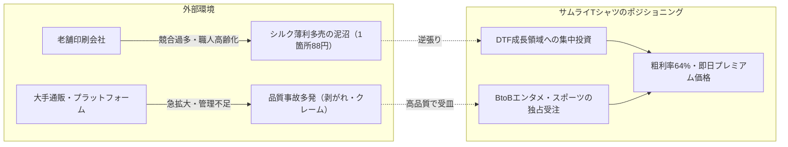

# 【知識ベース②：経営状況に関する知識】財務・戦略・組織体制・成長サイクル

## 1. 財務状況（第11期 確定決算データ）

* **純売上高**: **1億9,642万円**（前年比 142.6% / 2021年比で過去5年で売上5倍増）
  * Tシャツ売上: 1億8,879万円（主力のDTFが牽引）
  * 就労支援事業収入: 763万円（サムライプリント・B型事業所）
* **売上総利益（粗利）**: **1億2,624万円（粗利率 64.3%）**
  * 外注費わずか292万円。自社内製化率が極めて高く、圧倒的な付加価値構造。
* **営業利益・当期純利益**:
  * 営業利益: **505万円** / 当期純利益: **503万円**（前期の大幅赤字から**完全黒字転換**）
* **繰越利益剰余金**:
  * 期首 ▲3,488万円 ➔ 期末 ▲2,986万円（債務超過を約502万円縮小し、回復基調）。

### 季節サイクル（業務とキャッシュフローの波）
* **繁忙期（5〜7月、10〜11月）**:
  * 月商1,700万〜2,400万円規模（5月2,390万、6月2,296万）。現場キャパシティ（場所・人・機械）が限界を迎える。
* **閑散期（12〜2月）**:
  * 月商1,000万〜1,100万円規模（2月は1,079万円、営業赤字▲278万円）。
  * 創業以来課題だった「冬の閑散期のキャッシュアウト」を通期黒字で完全に吸収できる体質に進化。

---

## 2. 経営戦略とポジショニング（逆張り戦略）

1. **老舗シルクへの逆張り**:
   * 大量案件の価格競争に巻き込まれず、需要が急伸しているDTFへ設備・リソースを集中。
2. **大手プラットフォームの品質事故の受皿**:
   * 大手が品質管理できず顧客離れを起こす中、「高品質なDTFシート出力・圧着代行」で確固たる業界評価を獲得。
3. **即日圧着代行のプレミアム価格戦略**:
   * 短納期対応は安売りせず、「即日」という付加価値で高価格プレミアムを乗せて高利益率を叩き出す。

---

## 3. 成長の好循環サイクル（ボトルネックの本質）

澤田社長の成長方程式：**「場所 ➔ 人 ➔ 金 ➔ モノ」**

1. **場所（最優先ボトルネック）**:
   * 羽村工場と小作工場の合併（冬に実現見込み）＋小作工場2階の増床（資金調達完了）。
   * 場所さえ確保できれば、シャツの事前在庫保管と機械増設が可能になる。
2. **人（集客容易）**:
   * 駅近立地＋バイトル活用でパート応募が好調。採用の懸念は低い。
3. **金（キャッシュ創出）**:
   * 粗利64%の高収益体質により、月次の営業キャッシュフローが順調に増加中。
4. **モノ（機材投資）**:
   * 創出したキャッシュと調達資金をもとに、5ヘッド機（来期1〜2台）・プレス機（来期4台）を順次増設。

---

## 4. 組織体制と「家族経営からの脱却」の歴史

* **ステークホルダー・役員体制**:
  * **代表取締役：澤田 佳久**: 全体経営、営業、DTF設備投資、現場統括。
  * **取締役副社長：りつこ氏**: 澤田社長の妻。製造稼働の確保として就労継続支援B型事業所「サムライプリント」を立ち上げ・運営統括。
  * **株主・外部支援者**: **山本 圭 氏**、**伊藤 諭 氏（通称: ろんちゃん）**。友人として少額出資し、経営アドバイス・IT支援を実施。
* **家族経営からの脱却（人事の転換点）**:
  * 創業時からの社員でシルクスクリーンの主力技術者だった**トシ氏（りつこ副社長の息子）がコンプライアンス問題により退職**。
  * これを契機に、属人的なシルク職人技への依存を完全に断ち切り、**デジタル設備（DTF）への完全シフト**を決定。
  * 同時に世界的スポーツ大手 **Fanatics Japan の工場監査** を受けたことで、「コンプライアンス元年」として就業規則刷新・勤怠システム化（King of Time）を断行。
