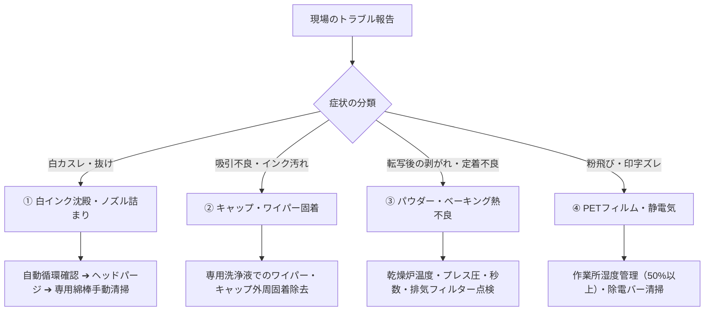

# 【知識ベース①：技術的側面】機材・トラブル対応・予防保全ノウハウ

## 1. 保有設備と機材スペック

* **主力機材**: **株式会社アステム（ASTEM）製「ARTJET（アートジェット）」シリーズ**
  * **最新鋭主力機**: **5ヘッド搭載DTFプリンター**（急増する受注に対応するため今期1台追加、来期1〜2台増設予定）
  * **上位高速機（参考）**: `AJ-0120`（ART JET EX / 4ヘッド、クリーニング液搭載、インクダンパー簡易ヒーター付）
  * **シェイクパウダードライヤー**: `AJ-0200` または `AJ-0220`（ホットメルトパウダー自動塗布・加熱乾燥炉）
  * **圧着機（熱プレス機）**: 今期3台増設、来期さらに4台増設予定
* **メーカー純正消耗品・清掃資材**:
  * 洗浄液: `AJ-4005`
  * クリーンスティック: `AJ-4210`
  * ポリウエスワイパー: `AJ-4220`
  * フィルターエレメントキット: `AJ-4300`

---

## 2. 頻出トラブルと一次切り分け・復旧フロー

### ① 白インク沈殿・ノズル詰まり（最重要・最頻出）
* **発生メカニズム**: 白インクに含まれる高比重の酸化チタン（顔料）が流路やヘッド内で沈殿・固着。
* **現場症状**: 白のカスレ、下地が透ける、特定ノズル列の抜け。
* **予防・復旧**:
  * 毎朝の自動循環・攪拌動作の確認。
  * ノズルチェック印刷 ➔ 通常ヘッドパージ実行。
  * 改善しない場合、`AJ-4005` 洗浄液を含ませたクリーンスティック（`AJ-4210`）でヘッド周辺を手動清掃。

### ② キャップステーション・ワイパー固着
* **発生メカニズム**: ワイパーゴムやキャップ吸引口に余剰インクが固着し、密閉性が低下。
* **予防・復旧**:
  * 専用洗浄液を含ませたポリウエスワイパー（`AJ-4220`）で日々の拭き取り清掃。

### ③ パウダードライヤーの加熱・塗布不良
* **発生メカニズム**: ホットメルトパウダーの塗布ムラ、または加熱炉の温度不足・ヒーター経年劣化。
* **現場症状**: Tシャツへの転写時にマークが剥がれる、洗濯堅牢度低下、パウダーの溶け残り。
* **予防・復旧**:
  * ドライヤーの設定温度（実測値）確認、排気フィルター（`AJ-4300`）の定期交換。

### ④ PETフィルム搬送・静電気
* **発生メカニズム**: 冬場の乾燥による静電気、フィルム送りテンションの狂い。
* **現場症状**: 余白部分へのパウダー付着（粉飛び・地汚れ）、送りズレ。
* **予防・復旧**:
  * 現場の湿度50〜60%維持、除電バー清掃、フィルム装填時の平行確認。

---

## 3. シルクスクリーンとの技術的比較（現場判断の基準）

| 比較項目 | DTF（Direct to Film） | シルクスクリーン印刷 |
| :--- | :--- | :--- |
| **製版** | **不要（データ即出力）** | **色ごとに版作成が必要**（製版コスト・時間発生） |
| **適正ロット** | 1枚〜数百枚（小〜中ロット・即納） | 数百枚〜数千枚（大ロット・定番） |
| **デザイン** | フルカラー、写真、グラデーション対応 | 単色、ベタ塗り、特色（PANTONE等） |
| **手作業工程** | **カス取り不要**（自動パウダー・プレスのみ） | 調色、版合わせ、手刷り職人技 |
| **対応素材** | 綿、ポリエステル（ドライ）、ナイロン、撥水 | 主に綿（ポリエステルはブリード対策が困難） |
