# 【企業・業界リサーチ】株式会社サムライTシャツ 会社概要・設備・表記揺れ知見

## 1. 会社概要・事業概要

| 項目 | 詳細情報 |
| :--- | :--- |
| **会社名** | 株式会社サムライTシャツ（英語表記: Samurai T-shirts Inc.） |
| **代表取締役** | **澤田 佳久（Yoshihisa Sawada）** |
| **所在地** | 〒198-0032 東京都青梅市野上町4-5-5（横田基地から車で約15分） |
| **連絡先** | TEL: 090-1246-4465 / Email: `samurai.tshirts@gmail.com` |
| **公式サイト** | https://samurai-tshirts.com/ |
| **所属団体** | 日本オリジナルTシャツ協会（JOTA）正会員 |

---

## 2. コア事業と現場の強み

1. **自社完結のマルチ加工設備**
   * シルクスクリーン印刷、DTF（Direct to Film）、インクジェット（DTG）、カッティング転写、刺繍など、アパレル加工に必要な全工程を自社工場内で内製化。
2. **DTFシート出力代行センターの運営**
   * 同業者・アパレルショップ向けに、朝6時入稿で即日発送などの「DTF転写シート出力代行」を展開。機材を持たない他社へのサプライチェーンの一角を担う。
3. **横田基地（米軍関連）との強固なリレーション**
   * 横田基地の至近に位置し、在日米軍部隊・イベント・スクール向けユニフォームやTシャツ制作の実績が極めて豊富（英語対応・米国規格対応）。
4. **就労継続支援B型事業所「サムライプリント」との連携**
   * 製造拠点において障がい者就労支援の場を併設・運営し、地域貢献と丁寧な手作業工程の両立を実現。

---

## 3. プリンター設備・業界での位置づけ（事例調査結果）

* **導入機材**:
  * **アステム社製「ARTJET（アートジェット）」** シリーズを複数台導入。
  * 業界向け展示会（OGBS: オーダーグッズビジネスショー）等でも注目される、DTF活用の先行・先進ユーザーとしてのポジション。
* **現場の技術的特徴**:
  * 従来の手作業（製版、カス取り、白フチ調整）をDTFで自動化・小ロット短納期化。
  * 白インクの管理、パウダードライヤーの温度管理、PETフィルム搬送等の現場運用ノウハウが日々の業務に直結している。

---

## 4. 表記揺れ・検索キーワード知見（ナレッジ収集用）

エージェントのログ検索、Webクローリング、社内データ突合時に網羅すべき表記パターン一覧です。

```mermaid
mindmap
  root((サムライTシャツ))
    日本語商号・屋号
      株式会社サムライTシャツ
      サムライTシャツ
      侍Tシャツ
      サムライプリント
      サムライ Tシャツ
    英語表記
      Samurai T-shirts Inc.
      Samurai T-Shirts
      Samurai Tshirts
      Samurai Print
    代表・拠点・特定ドメイン
      澤田佳久 / Yoshihisa Sawada
      samurai-tshirts.com
      青梅市野上町
      横田基地 / Yokota Air Base
    業界・展示会関連
      アステム / ARTJET / AJ-0100 / AJ-0120
      OGBS / オーダーグッズビジネスショー
      日本オリジナルTシャツ協会 / JOTA
```

### 検索クエリ設計時の推奨ルール
* **Web/SNS検索時**:
  * `("サムライTシャツ" OR "侍Tシャツ" OR "サムライプリント") ("DTF" OR "プリンター" OR "アステム")`
* **メール・チャットログ突合時**:
  * 社名揺れ（カタカナ / 漢字）に加えて、代表名 `澤田`、工場名 `サムライプリント`、メアド `samurai.tshirts@gmail.com` も検索スコープに含めること。
