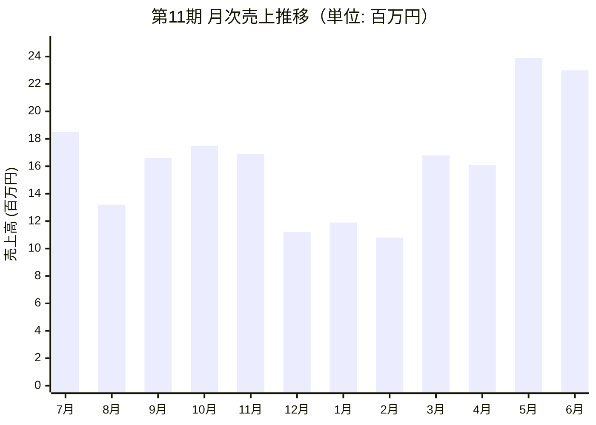

# 【財務・経営分析】株式会社サムライTシャツ 第11期決算分析（2025.07〜2026.06）

> **株主・支援者関係**:  
> 山本圭氏および友人・伊藤氏（通称: ろんちゃん）が個人出資者・アドバイザーとして経営支援を行っている。

---

## 1. 第11期 決算サマリー（確定値）

| 勘定科目 | 金額（円） | 前年比 | 構成比 / 粗利率 | 経営的インサイト |
| :--- | :--- | :--- | :--- | :--- |
| **純売上高** | **196,422,646** | **142.6%** | 100.0% | 約1.96億円。5年で5倍増の急成長ペースを維持。 |
| （Tシャツ売上） | 188,793,181 | 144.2% | 96.1% | 主力のDTF・プリント事業が牽引。 |
| （就労支援収入） | 7,629,465 | 112.7% | 3.9% | サムライプリント（B型事業所）の安定収入。 |
| **売上原価** | 70,181,010 | 125.0% | 35.7% | 外注費わずか292万円。自社内製化率が極めて高い。 |
| **売上総利益（粗利）**| **126,241,636**| **154.8%** | **64.3%** | **粗利率64.3%**。製造・印刷業として非常に高い付加価値。 |
| **販売費及び一般管理費**| 121,191,123 | 137.4% | 61.7% | 人件費・設備増設に伴う地代家賃・減価償却が増加。 |
| **営業利益** | **5,050,513** | **黒字転換**| 2.6% | 前期の大幅赤字から損益分岐点を突破。 |
| **経常利益** | **5,148,830** | **黒字転換**| 2.6% | 支払利息143万円（借入金あり）を営業利益・雑収入で吸収。 |
| **当期純利益** | **5,028,830** | **黒字転換**| 2.6% | **通期最終黒字約503万円を達成**。 |
| **繰越利益剰余金** | **▲29,858,620** | - | - | 前期末▲3,488万円から約503万円改善。債務超過縮小中。 |

---

## 2. 月次推移から見る「業務サイクルと季節性」

* **繁忙期（5月〜7月、10月〜11月）**:
  * 月商1,700万〜2,400万円規模。5月（2,390万円）、6月（2,296万円）がピーク。
  * 現場キャパシティの限界（人・機械・スペース）に直面する時期。
* **閑散期（12月〜2月）**:
  * 月商1,000万〜1,100万円規模（2月は1,079万円、営業損失▲278万円）。
  * 澤田氏の所感にある「冬の閑散期のキャッシュアウト」が顕著に表れる時期。
  * ただし通期では黒字化しており、冬の赤字を春夏の黒字で完全にカバーできる体質へ転換した。

---

## 3. コスト構造（販管費1.21億円の内訳と特性）

1. **人件費（計 4,960万円 / 販管費の約41%）**:
   * 従業員給与: 3,989万円（月300万〜420万円、パート増員で期末にかけて増加）
   * 法定福利費: 671万円
   * 従業員賞与: 203万円
   * パート採用（バイトル）と勤怠（King of Time）の自動化が進む領域。
2. **固定設備・場所（計 2,845万円 / 販管費の約23%）**:
   * 地代家賃: 1,671万円（月約130万〜140万円。小作・羽村工場の合併・2階増床計画あり）
   * 減価償却費: 1,173万円（DTF機・プレス機等の設備投資償却）
3. **現場変動費・発送費**:
   * 発送配達費: 716万円（前年比263%。DTFシート出力代行・完成品の出荷急増に伴う）
   * 修繕費: 349万円（前年比397%。マシンの稼働率上昇に伴うメンテナンス出費）

---

## 4. エージェント設計への財務インサイトの反映

* **判断基準の背景にある「財務の論理」**:
  * **値引き・短納期判断**: 粗利率64%と高収益である一方、繁忙期（5〜7月、10〜11月）は「これ以上受けると現場がパンクする」状態になるため、繁忙期の安易な値引き・特急受託は抑制すべき判断軸になる。
  * **修繕・メンテナンス判断**: 年間350万円の修繕費が発生しており、DTFマシンの予防保全（日々の清掃・白インク循環）を怠るとダイレクトに突発修繕費と現場停止リスクに跳ね返る。
  * **閑散期の投資判断**: 12月〜2月は売上が半減するため、追加投資（700万円の5ヘッド増設等）は「春以降の口座キャッシュ増」を確認してから実行するという澤田社長の慎重姿勢をエージェントの思考基準に反映させる。
