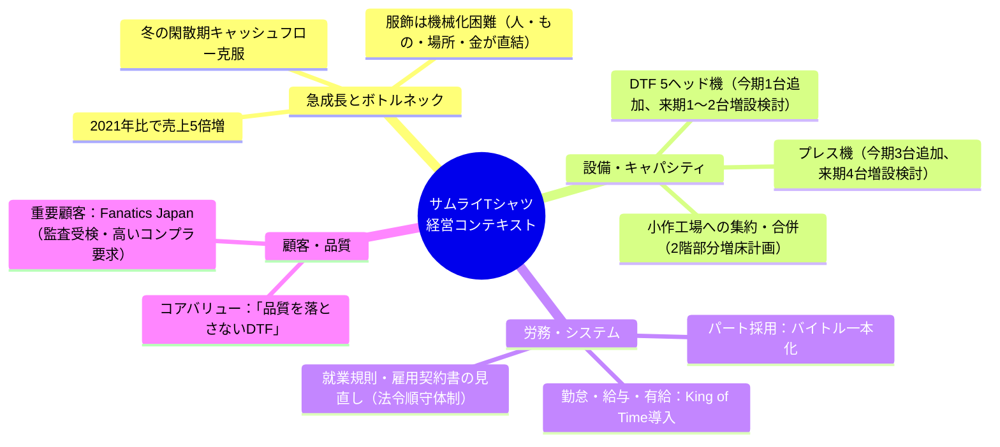
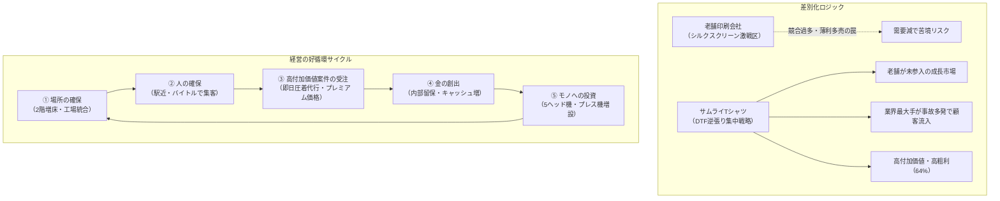

# 【経営一次資料】株式会社サムライTシャツ 第11期所感・第12期展望（澤田佳久代表）

> **資料概要**: 株主総会における代表取締役・澤田佳久氏の所感テキスト。  
> 支社長代理エージェントが会社の投資判断、キャパシティ限界、労務ルール、主要顧客属性を把握するためのコアコンテキスト。

---

## 全文テキスト（原文記録）

### 第 11 期(今期)の所感と第 12 期(来期)の展望に関して

弊社は一般的には印刷業となりますが、製造業というカテゴリーの一部であり、製造業の場合、「売上が増える=従業員の前を通る物量が増える」という職種のため、受注増及び受注増見込に伴い、人・もの・場所・金を用意しないと受注増に対応ができません。
ましてや服飾品の場合、どうしても人の手で生地を掴む必要があるため、機械化が難しく、他の製造業と比較しても一段と受注増に対して従業員の数を増やさないと対応ができないという職種になります。

ある程度の売上増であれば、対応はできますが、2021 年の決算から比較すると、過去 5 年で売上高が 5 倍増となっており、この急激な売上増に対応するのは本当に大変でした。先の需要を読んで、先行投資をしていくこと。言葉では簡単ですが、勘が全ての世界です。少しでも勘が狂って舵取りを間違えれば大きな失敗につながるという文字通り綱渡りの状態であり、未だにそれを続けていますが、幸運にも良い方向に向かっています。

前期は DTF(モノ)に対する先行投資、土地(場所)の拡大、動画等のブランディングに伴う出費で大幅な赤字となりましたが、今期はその効果を享受する年のなり、DTF を中心とした大幅な売上増を実現できました。冬の閑散期でキャッシュが無くなるという悪夢を見なかったのは創業以来初めての事です。
コロナ等で色々と邪魔が入りましたが、やっときっちりと損益分岐点を超えたという手応えがあり、まだ十分ではありませんが、近い将来、内部留保で先行投資ができる環境が整ってきたと思います。

来期の売上高は 125~130%と予想。人・モノ・場所・金という目線で今期を振り返りつつ、上記の予想に基づき来期の計画をお伝えします。

#### 「人」
バイトルを 3 月から何度か使用していますが、応募が多く、費用対効果が非常に高いため、パート募集はバイトルで全て賄おうと考えております。小作工場は交通機関からのアクセスが良く、なおかつ人口密集地にあるという点から、ターゲットとしている人材が集まりやすいため、「人」の対応に関してはそれほど心配をしておりません。
勤怠管理に関しても来期から King of Time という勤怠管理を導入する予定であり、給与計算・有給管理等も含めて、自動システム化する予定です。就業規則や雇用契約書に関しても今期から大幅に見直しを進めており、来期中に法令順守体制が整う予定です。

#### 「モノ」
DTF と圧着機(プレス機)を中心に増設を進めています。今期は 5 ヘッド 1 台、プレス機 3 台を追加しましたが、来期は 5 ヘッドを 1~2 台、プレス機を 4 台程度増やさないと対応が厳しいと思っておりますので、既に資金調達も含め、計画を立てております。

#### 「場所」
予定していた羽村工場と小作工場の合併が様々な障害で予定から大幅に遅れました。やっと 3 月に用途変更が完了し、建屋の買収計画等にも巻き込まれましたが、10 月に消防計画提出の目途が立ったため、冬に合併が実現できそうです。ただし、現在の取引量だと合併しても工場に余裕が全くないため、来期は小作工場の 2 階部分を部分的に借りる方向で計画を立てており、その資金調達も既に完了しております。

#### 「金」
「モノ」と「場所」の計画に伴う資金(1200 万円)は既に調達済み。
DTF の 5 ヘッドを更に増設する必要がある場合は 700 万円の資金が予算外で必要となりますが、5 月くらいから口座のキャッシュが毎月かなり増える経営環境になってきているため、冬の閑散期の赤字額を見ながら、内部留保を使用して来春に増設する事は可能かと思っています。

やっと計画を立て、その計画を粛々と実行するという環境になってきたかなと思います。多少計画に狂いが発生する事はあるかと思いますが、資金面でも人的な面でも少しだけ余裕ができてきたので、ある程度は何があっても安心できる状態です。

#### コンプライアンス
今期を「コンプライアンス元年」と位置付けています。法人格とはいえ、最初は家族経営で始まった組織ですから、労務等に関する整備やコンプライアンス遵守は後手に回る傾向がありました。Fanatics Japan との取引開始に伴い、監査を受ける機会があった事も大きく、今後の大きな BtoB とのお付き合いを含め、コンプライアンス遵守の体制づくりに取り掛かれたのは良い機会だと考えております。

#### 最後に
金融機関、商工会議所、会計事務所の方々からは「この勢いで伸びている会社は西多摩では知らない」と言われるようになりました。
オリジナルT協会や OGBS(展示会)、元請けや同業者との交流で、様々な方々から「DTF に関してはサムライ T シャツ」という良い評価を聞く機会が増えました。
売上増を支えている一番大きな要因はサービスも含めた「品質」だと思っています。来期に関しても、品質を落とすことなく、DTF を中心に業績を伸ばしていこうと考えております。

---

## エージェント設計上の重要抽出ポイント



1. **機材スペックの特定**:
   * DTFプリンターは「5ヘッド機」を運用（先ほどの4ヘッド機AJ-0120に加え、最新鋭の5ヘッドモデルを導入済み）。
2. **労務・社内ルールの参照先**:
   * 勤怠・給与・有給は `King of Time` 前提。
   * パート募集・採用基準は `バイトル` を軸とした小作工場エリア特性。
3. **重要顧客とコンプライアンス基準**:
   * 世界的スポーツマーチャンダイズ大手 **Fanatics Japan（ファナティクス・ジャパン）** との取引があり、同社の工場監査基準に耐えうる品質・労務管理が求められている。

---

## 株主総会後チャット記録（2026/09/27 澤田・伊藤・山本FBグループ）

> **出席・発言者**: 澤田佳久（代表）、伊藤諭（出資者/ろんちゃん）、山本圭（出資者）

### チャット原文
> **佳久**: 本日はありがとうございました  
> **佳久**: ええ、シルクの自動機を入れることにより、1箇所88円でも時速300箇所なので、利益は多く出ますが、それだけの仕事をコンスタントに取ってくる必要があります  
> うちは逆張りで、老舗がやっていない所を攻めていて、その結果、かなりの量の仕事が取れつつあるので、路線としては悪くないかと  
> DTFに集中し過ぎに見えるかもしれませんが、老舗と違う路線である事、今後需要が伸びる分野である事、最大手が事故を多く起こしている事から、まだまだ需要を取り込め、競合が少ない分野なのでDTFを伸ばしています  
> シルクは競合が多いので、シルクの需要が減った時に老舗は大変になるででょうねぇ  
> DTFの売上増に関しては意外と簡単で、ギフトショーに出展するというのがあります  
> かなり大手がウロウロしている展示会なので、2階を借りて拡張性を確保したタイミングで出展を考えています  
> 他にも圧着代行の即日発送（100枚限定）も考えています  
> 大変ではありますが、場所さえあれば、シャツを事前にメーカーから取り寄せておいて保管できます  
> 価格も即日という事で、同じ作業ですが、プレミアムを乗せ放題なので利益率も高いので、2階を確保したら早めにテスト運用するつもりです  
> **諭**: 色々と手が打てそうなのですね。そうなるとヒトの問題が重要になると思うので、無理せず、進めてもらえればと思います！  
> **佳久**: ありがとうございます  
> 人、モノ、場所、金  
> 場所がクリアできれば、駅近なので人が確保でき、売上増に応じて得た金をモノ使う  
> という良い循環が生まれるので、取り急ぎ2階をどうにか確保します  

---

## 澤田社長の戦略ロジック（エージェント判断基準への反映）



### エージェントが保持すべき重要判断軸
1. **ポジショニング（なぜDTFなのか）**:
   * シルクスクリーンの低価格・大量印刷の過当競争には巻き込まれない。
   * 「最大手が品質事故を起こしている」隙間に対し、「高い品質と信頼性のDTF」で顧客を総取りする方針。
2. **価格・サービス判断（即日・特急対応の思想）**:
   * 「即日発送・短納期」は、単なる無理な下請け対応ではなく、**「プレミアム（高単価）を乗せ放題にするための高収益戦略」**として位置づけている。
   * エージェントが特急案件を扱う際は、安売りせず「特急プレミアム価格」を前提とした回答ロジックを組むべき。
3. **ボトルネックの認識**:
   * 経営の起点・ボトルネックは常に「場所（作業スペース・在庫保管場所）」。工場2階の確保状況や現場のスペース余裕を意識したキャパシティ管理が求められる。

---

## 4. 組織体制と「家族経営からの脱却」の経緯（人事・コンプライアンス背景）

株主総会所感にあった「今期をコンプライアンス元年と位置付け、家族経営から脱却する」という方針の裏側にある重要人事・組織コンテキストです。

```mermaid
flowchart TD
    subgraph 経営・役員体制
        CEO["代表取締役：澤田佳久<br/>（全体経営・DTF設備投資・営業・工場統括）"]
        VP["取締役副社長：りつこ氏<br/>（澤田社長の妻／就労継続支援B型事業所統括）"]
    end

    subgraph 創業期〜転換点
        Toshi["元社員：トシ氏<br/>（りつこ副社長の息子）<br/>※シルクスクリーン主力技術者"] -->|コンプライアンス問題の発生| Retire["退職（関係解消）"]
    end

    subgraph 組織構造改革（現在）
        Retire --> Shift1["シルク依存の終焉 ➔ DTF標準化・完全シフト"]
        Audit["Fanatics Japan 工場監査"] --> Shift2["就業規則・雇用契約の全面刷新"]
        Shift2 --> Shift3["勤怠管理『King of Time』導入・自動システム化"]
        Shift3 --> Shift4["パート募集を『バイトル』で一般公募・駅近集客"]
    end
```

### キーパーソンと役割分担
* **澤田 佳久（代表取締役社長）**:
  * 全体経営、資金調達、DTF設備投資、大口営業、工場全体の稼働統括。
* **りつこ氏（取締役副社長）**:
  * 澤田社長の妻。製造稼働の確保・丁寧な手作業工程の担い手として、就労継続支援B型事業所「サムライプリント」の許認可取得を主導し、同事業所の運営・管理を統括。
* **トシ氏（元社員・退職済み）**:
  * りつこ副社長の息子。創業期からの社員でシルクスクリーン側の技術者・主力現場メンバーだったが、コンプライアンス問題を起こしたことにより退職。

### エージェントの判断ロジックへの影響
1. **「なぜシルクではなくDTFなのか」の人的裏付け**:
   * 技術の属人化の象徴だったシルク職人（トシ氏）の離脱により、会社として**「属人的な職人技（シルク）への依存を完全に断ち切り、パート・B型作業者でも高い再現性が出せるデジタル設備（DTF＋自動プレス機）へ移行する」**ことが生存戦略上、不可逆な決定事項となった。
2. **コンプライアンス・労務の厳格性**:
   * 身内であってもルール違反を許さないガバナンスへの脱皮、およびFanatics Japan等の大手BtoB監査基準に耐えうる組織化が最重要テーマ。
   * エージェントが労務・業務ルールを答える際は、過去のなあなあな慣習ではなく、**「新就業規則およびKing of Timeに準拠した厳格で客観的なルール」**を基本方針とする。
3. **部門・役割の切り分け**:
   * 工場パート（バイトル採用）のシフト・業務指示と、副社長（りつこ氏）が管轄するB型就労支援（サムライプリント）の工賃・作業領域を混同しない設計とする。


