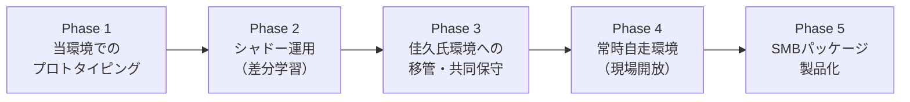

# 【ロードマップ＆基本構想】支社長代理エージェント構築とSMB展開

## 1. プロジェクトの背景と二重の狙い

本プロジェクトは、**「実案件でのプロトタイピング」** と **「中小企業（SMB）チャネルへの横展開・バラマキ施策」** の二重構造を持ちます。

> [!CAUTION]
> **【絶対期限（デッドライン）】：2027年6月 専務退任（任期満了）**
> * 専務（トシさん義兄）が2027年6月に退任（契約更新なし）することが決定している。
> * これに伴い、**専務が担っていた「現場の目配せ・パートの相談受け・日常の交通整理」がすべて澤田社長に跳ね返り、社長が現場に張り付いて経営が停滞する危機**がある。
> * **本プロジェクトの至上命題**: 2027年6月までに社長代理AIが現場の目配せ・一次判断の8割以上を完全肩代わりし、社長を現場雑務から解放する体制を完成させること。

```mermaid
flowchart TD
    subgraph 実証・プロトタイピング ["【現場実証】サムライTシャツ（澤田社長）"]
        A[過去1年のGmail判断ログ抽出] --> B[Antigravity上でプロトタイプ構築]
        B --> C[社長のシャドー運用・差分修正]
        C --> D[個別の実用エージェント自走化]
    end

    subgraph SMB横展開 ["【電算システム・SMB施策】パッケージ化"]
        B -.-> E[「支社長代理」型導入メソッド確立]
        C -.-> F[最小限のHuman-in-the-Loop設計標準化]
        D -.-> G[中小企業向けAI導入ソリューションパッケージ]
    end
```

* **狙いA（電算システム・SMBチャネル展開）**:
  * 中小企業が抱える「属人化・人手不足・社長や番頭への質問集中」を解決する標準モデルを確立し、SMB向け営業・導入パッケージとして横展開する。
* **狙いB（個別実証・実案件）**:
  * 幼馴染である澤田佳久社長（サムライTシャツ）の現場で実際に機能するエージェントを作り上げ、現場の一次相談・業務判断の8割以上を代行させる。

---

## 2. コア設計ポリシー

> [!IMPORTANT]
> **「秘書」ではなく「業務・判断の作業代替」×「最小限のHuman-in-the-Loop」**
> - **秘書要素の排除**: スケジュール調整や気配りではなく、現場が作業を進めるための「知識提供」「過去事例に基づく判断」を肩代わりする。
> - **自律性の最大化**: 社内規程と社長の過去判断ログをもとに、従業員からの相談にAIが自律して一次回答・作業代行を完結させる。
> - **人間の最小介入**: 人間（社長）の介在は「ルール未定義の例外対応」と「AIの回答修正（ルールの差分追記）」のみに限定し、社長の拘束時間を極小化する。

---

## 3. 実装・移管ステップ



### Phase 1：当環境（SMB-CEO-PoC-Samurai）でのプロトタイピング
* 佳久社長のGmailから抽出された「判断TOP10＋詳細要約Docs」を作業フォルダに集約。
* Antigravity上で、社長の判断ロジックを落とし込んだシステムルール（`rules`）と業務スキル（`skills`）を構築。
* 疑似的な従業員からの質問に対する回答精度をここで検証・完成させる。

### Phase 2：シャドー運用（社長の下働き）
* 従業員からの実際の相談をAIに通し、まずAIに回答案を作成させる。
* 社長がそれを確認し、ズレている部分のみサッと直してフィードバックする。
* この修正ログを蓄積することで、社長のリアルな判断軸を短期間でAIに叩き込む。
* **【発展構想】「社長アライメント問題集」によるチューニング（社長版RLHF）**:
  * 社長にゼロからルールを言語化させず、過去メールの実績から「この判断で合ってます？［自律OK / 条件付き / 社長にエスカレ］」という3択問題集をAIが自動生成。
  * 社長がスマホのスキマ時間でポチポチ回答するだけで、エスカレーションの閾値（権限委譲レベル）を高速にすり合わせる。

### Phase 3：佳久氏環境への移管と共同保守
* **アカウント・権限の分離**:
  * 会社ドメイン（GWS）と個人Gmail（実運用）の役割を整理。
* **共同メンテナンス構成**:
  * GitHubプライベートリポジトリ等でプロンプト・ルール一式を管理。山本氏が手元で改善してPushし、佳久氏側で同期できる仕組みを整備。
  * 必要に応じて初期設定はリモート接続（Chromeリモートデスクトップ等）で支援。

### Phase 4：常時自走環境の構築（本番稼働）
現場がいつでもチャット（Google Chat等）から相談できるように常時稼働させる。

* **推奨構成A（中小企業向けミニPC方式）**:
  * 事務所に小型PC（Intel N100搭載機等 / 2〜3万円）を1台設置。常駐エージェントとして24時間待機。
  * Tailscale等で外部から山本氏が安全にリモート保守可能。
* **推奨構成B（サーバーレスクラウド方式）**:
  * Google Cloud Run / 廉価VPS等でWebhookを受け付け、Gemini APIで即レスする構成。

### Phase 5：SMBパッケージ化
* 今回のプロセス（「GmailからGeminiで5分抽出」➔「Antigravityで代理構築」➔「シャドー運用でチューニング」）をテンプレ化し、中小企業向け導入サービスとして体系化する。
* **「社長の脳内インストールキット（問題集アライメント機能）」をキラー機能として搭載**:
  * 導入先企業の社長に負荷をかけず、過去メールから自動生成した質問集に答えてもらうだけで、各社社長の固有の判断軸・エスカレーション境界（権限委譲スライダー）が自動設定される導入パッケージとして製品化。

---

## 4. 費用・ライセンス設計（候補）

| 項目 | 構成案 | 想定コスト | 特徴・位置づけ |
| :--- | :--- | :--- | :--- |
| **API利用** | Google AI Studio（従量課金） | 月 数百円 〜 1,500円 | **最安・推奨**。現場相談規模ならGemini Flash中心で極めて低コスト。 |
| **ハードウェア** | 事務所常駐ミニPC（一括購入） | 20,000〜30,000円（初期） | 月額ゼロ（電気代数十円）。社長PCの電源断に依存しない。 |
| **開発・保守** | GitHub + Tailscale | 無料枠内で十分対応可能 | 山本氏側からの遠隔アップデート環境。 |

---

## 5. 関連リソースリンク
* 作業用共有フォルダ: [侍AI化プロジェクト（Google Drive）](https://drive.google.com/drive/folders/1b6-cEbbj0lB2JFad2p0OgSjms3Rv95hk)
* 佳久社長向け抽出ガイド: [【手順書】社長の判断ログをGeminiで5分で抽出するガイド](https://docs.google.com/document/d/15_BJinz3LYk7pWUemLYkIE88OdVS0NPePG4aJLQpq6g/edit)
* 連絡用チャットスペース: `spaces/AAQAIDiKCHY`
